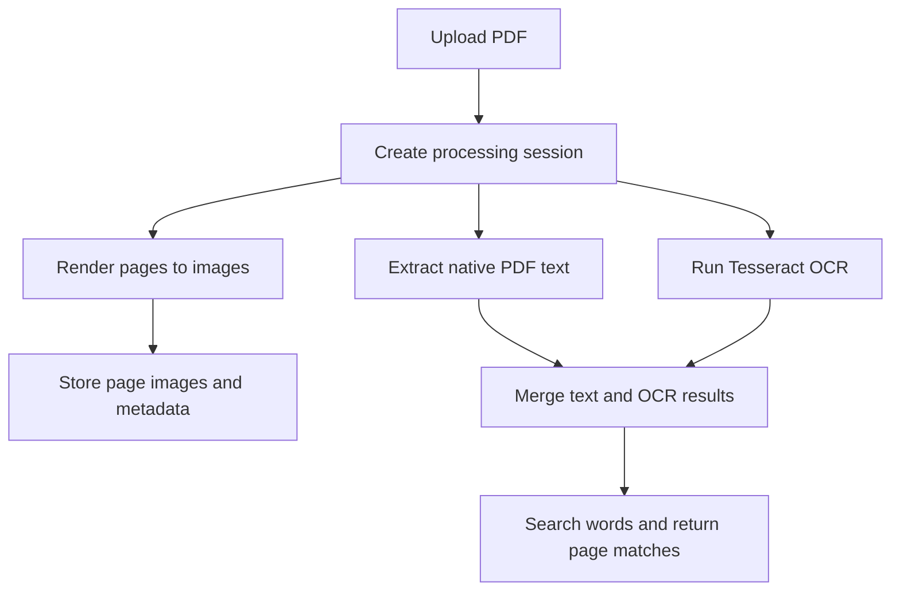

# ANVESHAK — OCR-Based PDF Search

ANVESHAK is a Python application for rendering PDF pages, extracting embedded/native text, applying Tesseract OCR to scanned pages, and searching extracted text with page-level match information.

> **Status: desktop-oriented prototype.** The current entry point launches through FlaskWebGUI, and the OCR executable is expected under a local `tesseract/` directory. Cloud deployment requires a separate packaging/configuration pass. Use only documents you are authorized to process.

## Features visible in the current code

- PDF upload and page rendering
- Native PDF text extraction
- Tesseract OCR with image preprocessing
- Concurrent processing of pages
- JSON metadata and page-level search results
- Search matches grouped by page
- Session library and cleanup endpoints

The current search statistics report a Kraken count of zero; Kraken OCR is not wired into the inspected search implementation.

## Processing flow



## Technology

- Python
- Flask
- PyMuPDF
- pytesseract
- Pillow
- FlaskWebGUI

## Repository layout

```text
app.py
Templates/
  index.html
README.md
```

### Known setup issue

The application configures Flask with `template_folder='templates'`, while the tracked HTML directory is named `Templates`. This case mismatch can break template loading on case-sensitive filesystems. Resolve it consistently before creating a public deployment.

The current code also points to `tesseract/tesseract.exe` and `tesseract/tessdata` relative to the application bundle. A clean installation guide and dependency manifest still need to be added and tested.

## Screenshots and demo

Screenshots and a live demo are not included yet. Add genuine screenshots showing PDF upload, page preview, search results, and highlighted matches after testing with a synthetic sample PDF.

## Security and privacy

Uploaded documents and generated metadata are stored under the local `Anveshak_Data` directory. Review session isolation, path validation, file-size limits, and cleanup behavior before exposing this service to other users. Do not use sensitive or restricted documents in a public demo.

## Author

Harish T · Python Backend Developer

Repository: https://github.com/Hari24022002/Anveshak-OCR
